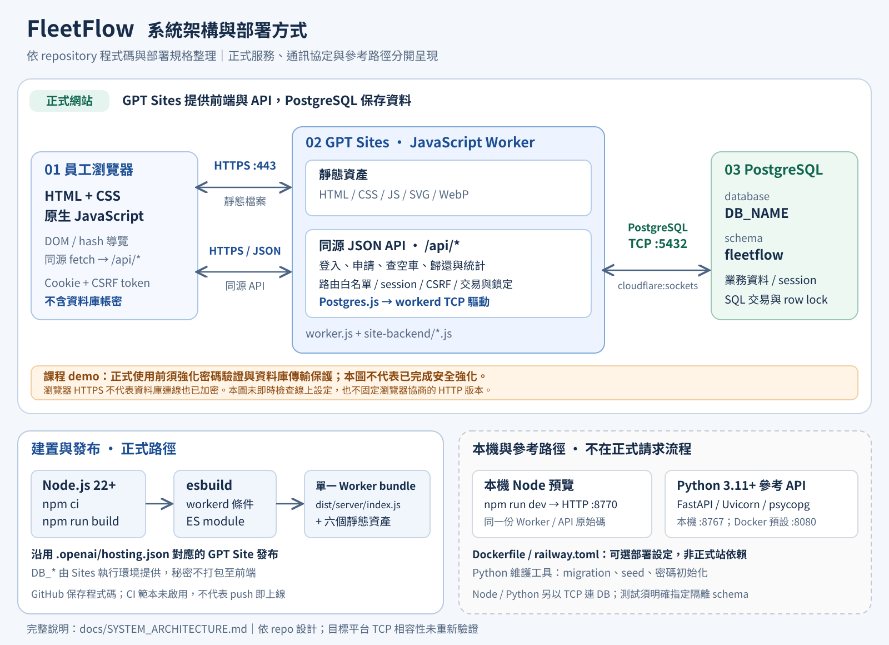
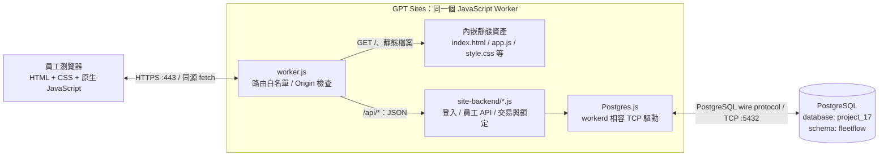
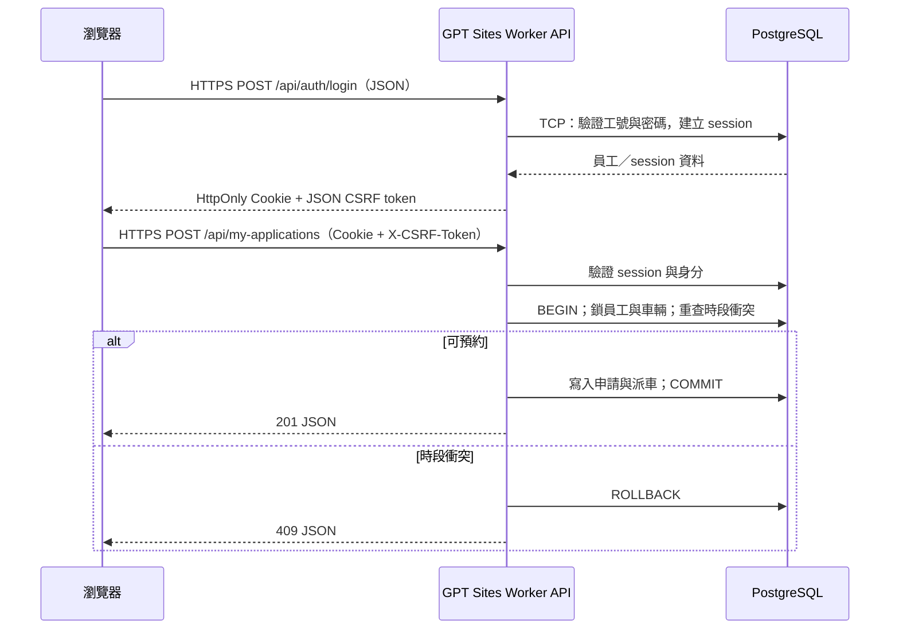
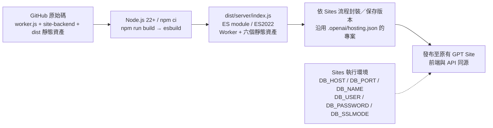
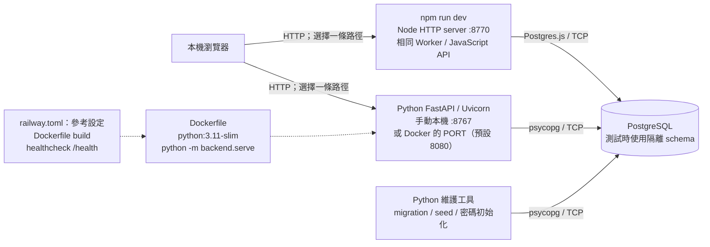

# 系統架構與通訊方式

本文件依目前 repository 的程式碼、建置設定與[部署規格](DEPLOYMENT_SPEC.md)整理。**正式網站使用 GPT Sites 的 JavaScript Worker，Python FastAPI／Docker／Railway 是另外保留的參考路徑**。圖中的正式部署方式取自 repo 設定與文件，不代表本次重新部署或即時探測了線上環境。

## 1. 系統總覽

[開啟可縮放的 SVG 架構圖](system-architecture.svg)。SVG 以文字與向量繪製，可直接編輯，不依賴外部圖片或字型檔。

### 正式請求路徑

- 瀏覽器只呼叫同網域 `/api/*`，不持有資料庫帳密，也不直接連線 PostgreSQL。
- 前端與 API 都由同一個 Worker 提供，不需要另一台 Node.js／Python API 伺服器。
- `site-backend/api.js` 還保留舊管理操作，但 `worker.js` 的路由白名單阻擋它們，不應畫成正式網站可用的管理 API。
- 資料持久化在 PostgreSQL。正式 Worker 不執行 migration；初始化與資料維護由 Python 工具另外處理。

**部署相容性提醒：**此圖描述 repo 設計與既有部署紀錄。`cloudflare:sockets` 能否在目標 GPT Sites 執行環境使用，仍須於部署時確認；成功建置不代表平台已支援 PostgreSQL 原生 TCP 連線。本次架構整理未驗證這項執行環境能力。

## 2. 程式語言與元件

| 層級 | 語言／技術 | 實際責任與原始碼 |
|---|---|---|
| 瀏覽器前端 | HTML、CSS、原生 JavaScript | 頁面、樣式、DOM 操作、hash 導覽與 `fetch`；[`dist/index.html`](../dist/index.html)、[`dist/style.css`](../dist/style.css)、[`dist/app.js`](../dist/app.js)。未使用 React、Vue 或 TypeScript。 |
| 正式 API | JavaScript ES modules、Fetch API、GPT Sites Worker | 路由與回應：[`worker.js`](../worker.js)；登入、員工業務與 SQL：[`site-backend/`](../site-backend/)。不是 FastAPI 或 Express。 |
| 資料存取 | JavaScript + SQL、Postgres.js | [`site-backend/db.js`](../site-backend/db.js) 建立 PostgreSQL 連線；預約使用交易、員工／車輛 row lock 與衝突重查。 |
| 資料庫 | PostgreSQL、SQL | `project_17` database 的 `fleetflow` schema；結構與 migration：[`backend/schema.sql`](../backend/schema.sql)、[`backend/migrations/`](../backend/migrations/)。資料庫伺服器版本未在 repo 指定。 |
| 建置／本機預覽 | Node.js 22+、JavaScript、esbuild | `npm run build` 封裝 Worker；`npm run dev` 以 Node HTTP server 執行同一份 Worker/API 原始碼。Node.js 是本機與建置工具，不是正式站的常駐伺服器。 |
| Python 工具／參考 API | Python 3.11+、FastAPI、Uvicorn、psycopg、Pydantic | [`backend/`](../backend/) 包含 migration、示範資料、密碼初始化及對照 API；依賴版本見 [`requirements.txt`](../requirements.txt)。 |

七個領域實體為部門、員工、車輛、申請、派車、保養及加油紀錄；另有員工電話、session、登入限流、migration 等支援資料表，不能將「七實體」誤讀成只有七張實體資料表。欄位與關聯請看 [ERD／關聯綱目](RELATIONAL_SCHEMA.md)。

## 3. API 與驗證邊界

正式 API 的請求／回應採 JSON。以下路徑均以網站同源 `/api` 開頭：

| 方法 | 路徑 | 用途／驗證 |
|---|---|---|
| POST | `/api/auth/login` | 工號與密碼登入；成功設定 session cookie，回傳員工資訊與 CSRF token。 |
| GET / POST | `/api/auth/session` / `/api/auth/logout` | 查目前登入狀態／登出；登出需 CSRF token。 |
| GET | `/api/employee-context` | 登入員工的個人資料、申請、行程、統計，以及共享預約與車輛紀錄。 |
| GET / POST | `/api/my-applications` | 查本人申請／建立申請；建立時在同一交易自動核准及派車。 |
| PUT / DELETE | `/api/my-applications/{id}` | 修改／刪除本人尚未開始且未歸還的預約。 |
| POST | `/api/my-applications/{id}/cancel` | 取消本人可取消的預約。 |
| GET / POST | `/api/my-dispatches` / `/api/my-dispatches/{id}/return` | 查本人行程／登記歸還。 |
| GET | `/api/availability?start=...&end=...` | 查指定時段空車；送出申請時仍會在交易內重查。 |
| GET | `/api/vehicles`、`/api/health` | 車輛列表／資料庫連線檢查；**兩者也需要員工 session**。 |

除登入外，上述 API 需要有效 session。受驗證的寫入請求需 `X-CSRF-Token`；Worker 也會拒絕帶有不同來源 `Origin` 的請求。伺服器依 session 決定員工身分，不能以修改 `employee_id` 取得他人私有資料。完整契約見 [API 規格](API_SPEC.md)；[`openapi.json`](openapi.json) 是 **Python 對照版**，不是正式 Worker 所有公開路由的清單。

session cookie 使用 `HttpOnly`、`SameSite=Strict`，HTTPS 時加 `Secure`，最長 8 小時。資料庫保存 session token 的 SHA-256 摘要。**員工密碼仍依課程 demo 需求明碼儲存，不能宣稱已雜湊**；詳見[安全規格](SECURITY_SPEC.md)。

## 4. HTTP、TCP 與 TLS

| 連線 | 協定／埠 | 重要區別 |
|---|---|---|
| 瀏覽器 ↔ 正式 GPT Site | HTTPS，預設 443；API payload 為 JSON | HTTP/1.1、HTTP/2 通常經 TLS/TCP；若平台協商 HTTP/3，則經 QUIC/UDP。repo 未固定 HTTP 版本，因此圖不宣稱瀏覽器連線一定是 TCP。 |
| 正式 Worker ↔ PostgreSQL | PostgreSQL wire protocol over TCP，`DB_PORT` 預設 5432 | Postgres.js 的 `workerd` 實作使用 `cloudflare:sockets`。這不是 HTTP API、WebSocket 或自訂 TCP server；是 Worker 主動向資料庫開啟 TCP 連線。 |
| 瀏覽器 ↔ 本機 Node 預覽 | HTTP，`127.0.0.1:8770`（可由 `DEV_PORT` 改） | 僅綁定 loopback；不等於正式部署。 |
| 本機 Node／Python ↔ PostgreSQL | PostgreSQL over TCP，預設 5432 | 分別使用 Postgres.js／psycopg。主機、帳號、密碼由環境設定提供。 |
| Python 參考 API | 本機例子 HTTP `127.0.0.1:8767`；容器預設 `0.0.0.0:8080` | Uvicorn 對外監聽埠由 `PORT` 決定，HTTP 與資料庫 TCP 連線是兩個不同層次。 |

### 資料庫 TLS 現況

[`docs/DEPLOYMENT_SPEC.md`](DEPLOYMENT_SPEC.md) 記載正式站目前 `DB_SSLMODE=disable`。JavaScript 驅動實作只有在值**恰為 `require`** 時啟用 TLS，其他值皆為 `false`，因此不能將目前的 Worker → DB 連線畫成已加密。

- 瀏覽器的 HTTPS **不會**自動保護 Worker 到資料庫這一段。
- `.env.example` 的 `prefer` 對 Python psycopg 有意義，但在目前 JavaScript 實作仍代表不啟用 TLS。
- 待資料庫支援 TLS 並驗證相容後，才可將 Worker 的 `DB_SSLMODE` 設為 `require`。這是改善建議，本文件未修改任何線上設定。
- 連線逾時 8 秒、SQL statement timeout 12 秒；每個 Postgres.js client 的 `max=1`，不是整個網站僅有一條連線。請求處理完成後關閉對應 client。來源：[`site-backend/db.js`](../site-backend/db.js)、[`site-backend/api.js`](../site-backend/api.js)、[`site-backend/employee-api.js`](../site-backend/employee-api.js)。

## 5. 建置與部署

### 正式：GPT Sites Worker

1. 依 [`package.json`](../package.json) 執行 `npm ci`、`npm run check`、`npm test`、`npm run build`。整合測試需可用的測試資料庫設定。
2. [`scripts/build-worker.mjs`](../scripts/build-worker.mjs) 以 `conditions: ['workerd', 'import']` 選擇 Postgres.js 相容實作，保留 `cloudflare:sockets` 與 `node:*` 執行環境模組。
3. 六個內嵌資產是 `index.html`、`style.css`、`app.js`、`config.js`、`favicon.svg`、`cullinan.webp`，輸出為 `dist/server/index.js`。資料庫秘密不放入前端或 bundle。
4. 依[部署規格](DEPLOYMENT_SPEC.md)使用相同來源版本的建置輸出及 `.openai/hosting.json`，更新原有 Site；設定與秘密由 Sites 執行環境提供，改值後需重新部署。
5. 正式網站不依賴 ngrok、Railway 或本機常駐服務。`docs/CI_TEMPLATE.yml` 僅為範本，repo 沒有已啟用的 GitHub Actions 發布 workflow，不能把 push 畫成一定自動上線。

### 本機與 Python 參考路徑

- Node 預覽由 [`scripts/dev-server.mjs`](../scripts/dev-server.mjs) 執行。未指定 `DEV_DB_SCHEMA` 時仍會用 `fleetflow`；隔離測試必須明確設定符合 `fleetflow_test_<12 hex>` 的 schema，不能把「本機」當作自動隔離。
- Python 參考 API 亦可提供 `dist` 靜態前端；啟動時執行 bootstrap/migration，且要求至少 32 字元的 `SERVICE_API_KEY`。員工路由用 session，其餘內部操作另有 service-key／loopback 限制。來源：[`backend/main.py`](../backend/main.py)、[`backend/bootstrap.py`](../backend/bootstrap.py)。
- [`Dockerfile`](../Dockerfile) 使用 `python:3.11-slim`，安裝 Python 依賴、複製 `backend` 與 `dist`，以非 root 使用者執行 `python -m backend.serve`；[`backend/serve.py`](../backend/serve.py) 讀取 `PORT`，預設 8080。
- [`railway.toml`](../railway.toml) 指定 Dockerfile 建置、`/health` 健康檢查（60 秒）及失敗重啟上限 3 次。這是可選參考設定，不代表正式站部署於 Railway，也不代表 repo 已建立可用的 Railway 服務。

## 6. 維護這份架構圖

路由、資料庫驅動、建置入口或部署方式改變時，請同步更新本文件與 [`system-architecture.svg`](system-architecture.svg)，並保留正式與參考路徑的區分。優先核對程式碼，不將歷史註解或未啟用的部署範本當作現況。
